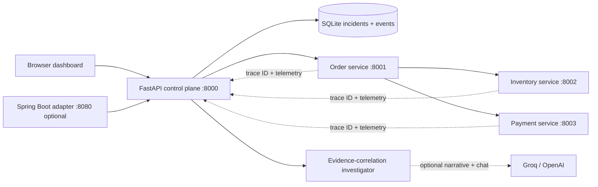

# TraceMind AI

**A runnable hackathon-ready demo app for evidence-driven incident investigation.**

TraceMind AI deliberately breaks a small HTTP checkout system, collects real service-to-service request evidence, correlates an incident to a probable cause, proposes a **demo-only** configuration mitigation, requires explicit human approval, then proves whether that mitigation worked by running three actual checkout requests.

> This is a **working, local hackathon prototype**, not the entire production system envisioned in the master specification. The fault conditions and database pool are intentionally *simulated*. The HTTP requests, emitted evidence, incident lifecycle, approval gating and verification requests are real. No fake metrics, fabricated AI analysis or claimed GitHub PR execution.

## Quick start (macOS, Windows, Linux)

Requires Python 3.10+ (3.12+ recommended), pip, and available ports **8000, 8001, 8002, 8003**. No Docker, Node, Maven, API key or cloud account is needed for the working MVP.

```bash
# 1. Unzip and enter the project folder
cd tracemind-ai

# 2. Create and activate a virtual environment
python3 -m venv .venv
source .venv/bin/activate            # Windows PowerShell: .venv\Scripts\Activate.ps1

# 3. Install dependencies
pip install -r requirements.txt

# 4. Start all 4 services
python run_demo.py
```

Open **http://127.0.0.1:8000**. The auto-generated HTTP API docs are at **http://127.0.0.1:8000/docs**.

On Windows, you may use `py -m venv .venv` and `py run_demo.py` instead of the Python commands above.

**Stop everything:** Press `Ctrl+C` in the terminal running `run_demo.py`.

### Try the core flow

1. For the fastest judge demo, click **Run guided investigation** to reproduce, analyze, and propose a mitigation in one step (without auto-approval). Or, on **Overview**, click **DB pool exhaustion**. The payment service receives a 1-slot simulated pool instead of 8. A real checkout request then propagates an HTTP 503 into an HTTP 502, and creates an incident.
2. Open **Incidents** and select the newly created incident.
3. If you used the manual failure button, click **Investigate trace**. The investigator correlates captured inventory, payment, order and gateway events. (The guided button already performs this step.)
4. If you used the manual flow, click **Propose mitigation**. Review the exact config diff. (The guided button already proposes the mitigation.)
5. Click **Approve mitigation**. No change is applied until this explicit step.
6. Click **Apply & run 3 verification tests**. Three live checkout requests must return HTTP 201 for the incident to resolve.
7. Explore **Distributed traces**, **Logs explorer**, **Services & topology**, and **AI copilot** (offline rule-based mode or optional LLM chat).
8. Repeat with **Payment timeout**. The payment service takes 1600ms while the order timeout is 700ms.

**Voice demo:** Install Wispr Flow separately, focus the **AI copilot** input, dictate “Why is the payment service failing and what evidence supports the root cause?”, and submit. No undocumented Wispr API is used.

## What works now

| Feature | Status |
| --- | --- |
| Dashboard + responsive navigation | ✅ Implemented |
| Three separate local HTTP microservices | ✅ Implemented |
| Deterministic demo faults: pool exhaustion and timeout | ✅ Implemented |
| Real requests, trace-ID propagation, telemetry storage | ✅ Implemented (custom minimal telemetry, not OpenTelemetry) |
| Trace waterfall + logs explorer | ✅ Implemented (custom spans) |
| Persistent incident records + severity/status | ✅ Implemented (SQLite) |
| Evidence-backed root-cause hypotheses | ✅ Implemented (deterministic engine) |
| Optional real-LLM narrative and grounded investigation chat | ✅ Supports `GROQ_API_KEY` or `OPENAI_API_KEY`; requires your own credentials, not live-tested against providers here |
| Evidence-backed chat | ✅ Implemented (offline fallback; optional actual LLM with provider API key) |
| Human-approved configuration diff | ✅ Implemented |
| Live verification with 3 checkout HTTP calls | ✅ Implemented |
| Incident Markdown report | ✅ Implemented |
| Spring Boot REST adapter source | 🧪 Included, **not compiled here**; requires Maven and Java 21 |
| OpenTelemetry/Jaeger/Kafka/Redis/pgvector | ⏳ Not implemented |
| Autonomous patching, code execution, GitHub PRs | ⏳ Not implemented |
| Authentication / organization isolation | ⏳ Not implemented (isolated disposable public demo only) |
| Dockerfile, Render configuration, GitHub Actions | ✅ Included; public deployment requires your hosting account |

## Architecture



**Do not interpret simulated failure scenarios as measured production database faults.** The actual observable events are real HTTP responses and their timings, while the payment `pool_size` represents a modelled concurrency requirement.

## Optional real LLM-powered chat and narrative

By default the investigator correlates trace evidence with deterministic, explainable rules. It works fully offline once dependencies are installed. To enable **real AI-powered chat plus an LLM-written investigation narrative**, use a server-side Groq or OpenAI API key. Never put keys in frontend code or send them in chat. Groq takes precedence when both are provided:

```bash
export GROQ_API_KEY='your-api-key'
export GROQ_MODEL='llama-3.3-70b-versatile'
# Or use: export OPENAI_API_KEY='...' and OPENAI_MODEL='gpt-4o-mini'
python run_demo.py
```

This sends **selected telemetry message text and status/duration fields** to the external provider. Review your organization's data policies before enabling it. The LLM output is labeled as an unverified narrative, and cannot override the evidence or automatically approve a fix. Providers are fixed to official HTTPS endpoints; there is no arbitrary user-controlled LLM URL. This mode requires working provider credentials and is not tested against a live provider in this deliverable.

## Optional Spring Boot control plane (Java 21)

A lightweight Spring Boot adapter is included in `java-control-plane/`. It exposes REST endpoints at port **8080** and forwards them to the functioning Python engine, separating the Java API surface from the Python investigator:

```bash
# In terminal 1:
python run_demo.py

# In terminal 2 (requires Java 21 and Maven installed separately):
cd java-control-plane
mvn spring-boot:run
# GET http://127.0.0.1:8080/api/v1/overview
```

This adapter is *not* a Java-native telemetry engine, and the current dashboard uses the FastAPI API directly. The Spring Boot module was not compiled in the creation environment because Maven was unavailable. Run its tests in your Java development environment.

## Public deployment and submission

- See [`docs/DEPLOY.md`](docs/DEPLOY.md) to host the **public judge demo** from the included Dockerfile / Render blueprint. The service has no authentication and must never handle production data.
- See [`docs/HACKATHON_SUBMISSION.md`](docs/HACKATHON_SUBMISSION.md) for the actual Wispr Flow registration, usage screenshot, publicly available URL, and demo video checklist. You must provide genuine screenshots and real dictation history.
- See [`docs/DEMO_SCRIPT.md`](docs/DEMO_SCRIPT.md) for a recording script under two minutes.
- Deadline: **31 October 2026 at 11:59 PM IST**, per the official WeMakeDevs challenge website.

## Automated tests

```bash
# Pure Python persistence and investigation tests
python -m pytest -q tests/test_investigator.py tests/test_llm.py

# In a second terminal while `python run_demo.py` is running:
python tests/smoke.py
```

The smoke test resets demo data, validates a healthy HTTP 201 checkout, runs both fault scenarios end to end, tests mandatory approval before verification, and checks all six successful verification checkouts. It will delete demo incidents created before it; use it on a disposable local workspace.

## Project layout

```
tracemind-ai/
├── run_demo.py                    # Starts 4 local ASGI servers
├── requirements.txt
├── engine/
│   ├── main.py                    # Control plane, endpoints, verification workflow
│   ├── services.py                # Order, inventory, payment microservices
│   ├── store.py                   # SQLite persistence
│   ├── investigator.py            # Evidence-based hypotheses and config diffs
│   └── llm.py                     # Optional LLM narrative
├── frontend/
│   ├── index.html                 # Dashboard shell
│   ├── styles.css                 # Responsive dark-theme design
│   └── app.js                     # API-connected view and actions
├── java-control-plane/           # Optional Spring Boot adapter
├── tests/                        # Unit and live end-to-end tests
└── docs/                         # Architecture, roadmap, demo script
```

## Limitations and safety

- Runs on `127.0.0.1` for local development; a Docker-hosted disposable demo can expose the control plane via `PUBLIC_DEMO=1`. There is **no user authentication, ingest API token, encryption at rest or production multi-tenancy**.
- Microservice fault injection is deterministic and deliberately controlled. The connection pool is a simulation, not a real JDBC/Postgres pool.
- Captured spans are a custom minimal trace format; **OpenTelemetry SDK/Collector/Jaeger are future work**.
- Hypothesis confidence is **heuristic**, not a calibrated statistical probability.
- “Apply & verify” updates **demo runtime configuration**, not a production source file. This is explicitly labeled throughout the UI.
- The optional AI narrative is unverified and may be inaccurate. Its failure never blocks deterministic investigations.
- No arbitrary AI-written shell commands, branch pushes, database writes to production systems, or deployments are performed.
- Persistence is a local SQLite DB at `data/tracemind.db` by default, created at first run. `Reset demo` clears it.
- No persistent authentication or external GitHub integration is shipped in this MVP. A public demo has basic per-IP throttling but is **not production secure**.

See `docs/ROADMAP.md` for the next serious engineering milestones.
